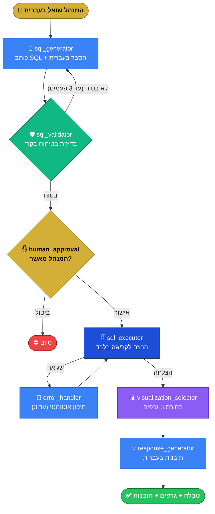

<div align="center">

# 🚗 DataAnalyst AI

### שואלים בעברית — מקבלים תשובה מהנתונים, גרפים ותובנות

**אנליסט נתונים אישי למנהל חברת הרכבים, בלי SQL, בלי אקסלים ובלי לחכות לאף אחד**


</div>

---

## 🎯 המטרה: לפתוח את הנתונים למנהל

לחברה יש מאגר נתונים עשיר: **מכירות, סניפים, עובדים, לקוחות, רכבים ומלאי**. עד היום המידע הזה היה **נעול** בשביל המנהל:

| ❌ עד עכשיו | ✅ עם DataAnalyst AI |
|---|---|
| כדי לקבל תשובה צריך לדעת SQL | שואלים בעברית חופשית, כמו שמדברים |
| כל שאלה = פנייה לאנליסט והמתנה של ימים | תשובה תוך שניות |
| דוחות קבועים מראש, בלי גמישות | כל שאלה שעולה לראש, מתי שרוצים |
| טבלאות של מספרים | טבלה + **3 גרפים** + **תובנות עסקיות** בעברית |
| חשש לגעת במאגר הנתונים | גישה בטוחה, לקריאה בלבד, באישור המנהל |

> [!IMPORTANT]
> **המטרה היא לתת למנהל גישה ישירה למידע שלא היה לו עד עכשיו**, כדי לקבל החלטות על סמך נתונים: איזה סניף מוביל, מי העובדים החזקים, מה המגמות, איפה כדאי להגדיל מלאי.

---

## 💬 מה אפשר לשאול?

| תחום | דוגמאות לשאלות |
|---|---|
| 🏢 **סניפים** | "איזה סניף הכניס הכי הרבה כסף השנה?" · "מה אחוז ההכנסות של כל סניף?" |
| 👥 **עובדים** | "מי העובד שמכר הכי הרבה רכבים ב-2024?" · "מה המשכורת הממוצעת לפי תפקיד?" |
| 🚙 **רכבים** | "מה הרכב הנמכר ביותר לפי קטגוריה?" · "כמה רכבים חשמליים נמכרו בכל שנה?" |
| 🌍 **שווקים** | "השווה מכירות בין המדינות" · "כמה לקוחות יש בכל מדינה?" |
| 📈 **מגמות** | "מה המגמה החודשית של המכירות ב-3 השנים האחרונות?" · "מה אחוז הצמיחה לפי רבעון?" |
| 📦 **מלאי** | "אילו סניפים מחזיקים יותר מ-20 רכבים חשמליים?" |

**מה מקבלים בחזרה:**

- 📋 **טבלת תוצאות** נקייה
- 📊 **3 גרפים** שנבחרים אוטומטית לפי סוג הנתונים (עמודות, מגמה, עוגה, פיזור, היסטוגרמה, מפת חום)
- 💡 **3–4 משפטי תובנות** בעברית פשוטה, כולל המלצה

---

## ⚙️ איך זה עובד?



| # | שלב | מה קורה |
|:-:|---|---|
| 1 | 🧠 **יצירת SQL** | GPT-4o-mini הופך את השאלה לשאילתה ומסביר בעברית פשוטה מה היא תעשה |
| 2 | 🛡️ **בדיקת בטיחות** | קוד פייתון (ולא רק פרומפט) מוודא שזו שאילתת קריאה בלבד |
| 3 | ✋ **אישור המנהל** | הסוכן עוצר ומציג: *"הסוכן מתכנן לבצע:..."*. כלום לא רץ בלי אישור |
| 4 | 🗄️ **הרצה** | השאילתה רצה על מאגר שנפתח במצב קריאה בלבד |
| 5 | 🔧 **תיקון עצמי** | אם יש שגיאה, הסוכן מתקן את השאילתה לבד, עד 3 ניסיונות |
| 6 | 📊 **בחירת גרפים** | ניתוח העמודות (תאריכים, קטגוריות, מספרים) ובחירת 3 גרפים מתאימים |
| 7 | 💡 **תובנות** | סיכום עסקי קצר בעברית |

---

## 🔒 אבטחה: אי אפשר לשנות או למחוק נתונים

> [!NOTE]
> הסוכן יכול **רק לקרוא** נתונים. יש 3 שכבות הגנה, וכל אחת מהן לבדה מונעת שינוי במאגר.

| שכבה | הגנה |
|:-:|---|
| 🟢 **1** | בדיקת regex בקוד: מותרת רק פקודת `SELECT` / `WITH` אחת. נחסמים `INSERT` `UPDATE` `DELETE` `DROP` `ALTER` `CREATE` `TRUNCATE` ועוד. הערות ומחרוזות מנוטרלות לפני הבדיקה כדי שלא יהיה אפשר להסתיר בהן פקודה |
| 🔵 **2** | חיבור למאגר במצב `mode=ro` (קריאה בלבד ברמת הקובץ) |
| 🟣 **3** | `PRAGMA query_only=ON`, מגבלת זמן של 10 שניות ועד 5,000 שורות |

גם שאילתה שתוקנה אוטומטית עוברת שוב את בדיקת הבטיחות, ושום שאילתה לא רצה בלי אישור המנהל.

---

## 🚀 התקנה והרצה

**1. התקנת החבילות**
```powershell
pip install -r requirements.txt
```

**2. הגדרת מפתחות:** מעתיקים את קובץ הדוגמה וממלאים בו את המפתחות
```powershell
copy .env.example .env
```

| משתנה | מאיפה | חובה? |
|---|---|:-:|
| `OPENAI_API_KEY` | [platform.openai.com/api-keys](https://platform.openai.com/api-keys) | ✅ |
| `LANGSMITH_API_KEY` | [smith.langchain.com](https://smith.langchain.com) ← Settings ← API Keys | לטרייסים ול-evaluation |
| `LANGCHAIN_TRACING_V2` | `true` לשמירת טרייסים ב-LangSmith | — |
| `PROMPT_VERSION` | `improved` (ברירת מחדל) או `baseline` | — |

> [!WARNING]
> הקובץ `.env` מופיע ב-`.gitignore` ולא עולה ל-Git. אל תשתפו את המפתחות שלכם.

**3. הפעלה**
```powershell
streamlit run app.py
```

> [!TIP]
> המאגר `database/car_company.db` כבר כלול בפרויקט. כדי לבנות אותו מחדש: `python database\create_db.py`

---

## 🗃️ הנתונים

| טבלה | שורות | מה יש בה |
|---|--:|---|
| 🏢 `branches` | 10 | סניפים ב-10 מדינות: ישראל, ארה"ב, בריטניה, צרפת, גרמניה, יפן, איחוד האמירויות, ברזיל, אוסטרליה, קנדה |
| 👥 `employees` | 50 | עובדים, תפקידים ומשכורות |
| 🧑‍💼 `customers` | 200 | לקוחות פרטיים ועסקיים מ-13 מדינות |
| 🚙 `vehicles` | 250 | 8 מותגים, 5 קטגוריות, שנות דגם 2018–2024 |
| 💰 `sales` | 1,000 | מכירות 2020–2024 עם מחיר סופי ואמצעי תשלום |
| 📦 `inventory` | 770 | מלאי נוכחי לפי סניף ורכב |

---

## 🧪 הערכת איכות (LangSmith)

40 שאלות בעברית (14 קלות · 14 בינוניות · 12 קשות), ושלושה מדדים:

- ✅ `sql_executes_successfully`: האם השאילתה רצה בלי שגיאה
- 📋 `has_results`: האם חזרה לפחות שורה אחת
- 🔤 `sql_contains_expected`: האם ה-SQL מכיל את המילים הצפויות (0 עד 1)

**ניסוי A מול ניסוי B:**

| מדד | 🅰️ baseline<br/>Schema בלבד | 🅱️ improved<br/>Schema + כללים + דוגמאות SQL | Δ |
|---|:-:|:-:|:-:|
| השאילתה רצה | **1.000** | 0.975 | 🔻 ‎-0.025 |
| יש תוצאות | 0.975 | 0.975 | ➖ 0 |
| התאמה ל-SQL הצפוי | 0.979 | **0.995** | 🔺 ‎+0.016 |
| טוקני קלט | **15,267** | 51,827 | ×3.4 |

> [!NOTE]
> כל פרומפט נכשל בשאלה אחת מתוך 40. **A** סכם את המלאי לא נכון (בדק שורה בודדת במקום סכום לסניף). **B** נכשל בחישוב רבעונים, כי ב-SQLite אין פונקציית רבעון. ההבדל בין הפרומפטים הוא בגבולות שאלה אחת. באפליקציה עצמה, `error_handler` היה מנסה לתקן את השגיאה של B. הניסוי בודק רק את הניסיון הראשון.

**הרצה:**
```powershell
python -m evaluation.evaluators --check
```
בדיקה מקומית, בלי LLM: מוודאת ש-40 שאילתות הייחוס תקינות.
```powershell
python -m evaluation.evaluators
```
מריצה את ניסויים A ו-B ב-LangSmith ומדפיסה את ההפרש. התוצאות המלאות נמצאות ב-LangSmith ← Datasets & Experiments ← `dataanalyst-ai-car-company-40` ← בוחרים את שני הניסויים ← **Compare**.

---

## 🧑‍💻 למפתחים: הרצת הגרף מקוד

```python
from langgraph.types import Command
from agent.graph import app
from agent.state import initial_state

config = {"configurable": {"thread_id": "demo-1"}}
app.invoke(initial_state("איזה סניף הכניס הכי הרבה כסף השנה?"), config)

# הגרף עצר לאישור, וזה מה שהסוכן מתכנן לבצע:
print(app.get_state(config).tasks[0].interrupts[0].value)

result = app.invoke(Command(resume=True), config)   # אישור (False = ביטול)
print(result["results"], result["chart_types"], result["insights"])
```

---

## 📁 מבנה הפרויקט

```
dataanalyst-ai/
├── 🖥️  app.py                  ממשק Streamlit
├── 📊 charts.py               בניית גרפי Plotly
├── 🧠 agent/
│   ├── graph.py               LangGraph StateGraph
│   ├── nodes.py               7 הנודים
│   ├── state.py               AgentState
│   └── prompts.py             פרומפטים + Schema
├── 🗄️  database/
│   ├── car_company.db         מאגר SQLite
│   ├── create_db.py           בניית המאגר
│   └── executor.py            בדיקת בטיחות + הרצה לקריאה בלבד
├── 🧪 evaluation/
│   ├── dataset.py             40 שאלות + תשובות צפויות
│   └── evaluators.py          LangSmith evaluators + ניסויי A/B
├── .env.example
└── requirements.txt
```

---

<div align="center">

**🛠️ נבנה עם** LangGraph · LangChain · GPT-4o-mini · Streamlit · Plotly · SQLite · LangSmith

</div>
